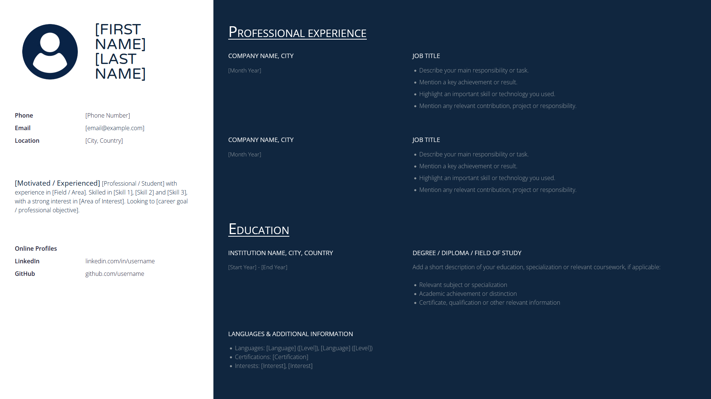

# Responsive HTML/CSS Resume Template

A clean, modern, and fully responsive **HTML5 and CSS3 resume template** designed to help professionals and students quickly showcase their profiles, professional experiences, and skills on GitHub Pages or a personal website.



## Features

- **Clean Layout:** Split-pane modern design optimizing profile summaries, experiences, and education sections.
- **Fully Responsive:** Adapts flawlessly across modern smartphones, tablets, and desktop displays.
- **Easy Customization:** Clear code annotations indicate exactly where to insert personal information, contact details, and custom paths.
- **Reset Baseline:** Built with CodePen's standard CSS Reset for reliable cross-browser styling rendering.

## Project Structure

```text
├── index.html          # Core template markup with descriptive instructions
├── css/
│   └── style.css       # Main visual layout and component styles
├── assets/
│   └── img/
│       ├── user.png    # Placeholder image for the profile avatar
│       └── screenshot.png # Repository preview/screenshot image
```

## Setup & Customization

Follow these simple steps to adapt this template to your background:

1. **Clone the Repository:**

   ```bash
   git clone https://github.com
   ```

2. **Personalize `index.html`:**
   - Open the file in your preferred text editor (e.g., VS Code).
   - Replace all placeholders enclosed in brackets like `[Your Name]`, `[Phone Number]`, and `[Job Title]` with your actual data.
   - Update online URLs such as LinkedIn and GitHub profiles.

3. **Add Your Profile Picture:**
   - Place your portrait in the `assets/img/` directory.
   - Update the `` source tag near the top of the file:
     ```html
     
     ```

4. **Customize Visual Themes:**
   - Modify layout dimensions, fonts, or primary colors directly inside `css/style.css` to suit your preference.

## Previewing Locally

Double-click `index.html` on your machine to open it instantly inside any web browser, or use local server extensions like **Live Server** in VS Code for real-time live preview modifications.
